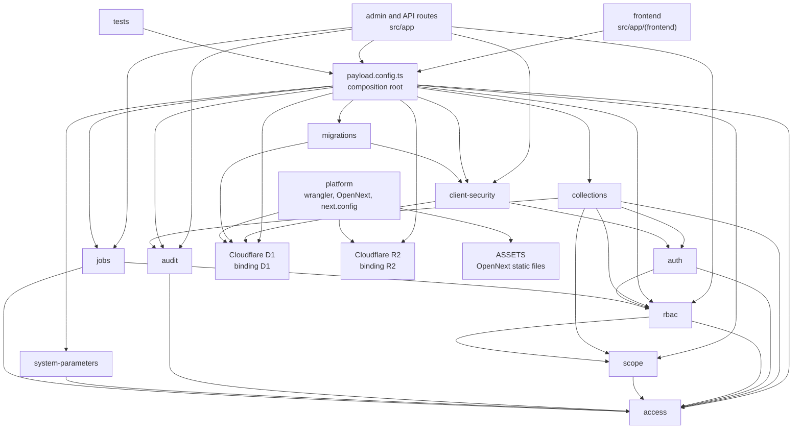

# Architecture

Last reviewed against branch `feat/45-in-code-modules` head (2026-10-24), which is based on `main` `29262dd`. This is the map of the code in this tree.

## What this repository is

A Payload CMS 3.91.0 admin template on Next.js 16.4 (App Router, webpack build) and React 19.3, deployed to Cloudflare Workers with `@opennextjs/cloudflare` 1.20.11. The database is Cloudflare D1 through `@payloadcms/db-d1-sqlite`. Uploads go to Cloudflare R2 through `@payloadcms/storage-r2`. The editor is Lexical. Firebase native clients (App Check plus Anonymous Authentication ID tokens) are verified with `jose`, separately from Payload admin sessions. License: MIT.

Node 22 (`.nvmrc`), `engines.node` `>=22.14.0`. Package manager is pnpm 10.33.4 (`packageManager`); `engines` accepts pnpm 9, 10, or 11. Wrangler is `~4.116.0` (4.116.0 in the lockfile). Exact versions are in `pnpm-lock.yaml`.

## Current modules

Every top-level directory under `src/` is a module with one public `index.ts`, except three groups the boundary test (`groupOf` in `tests/unit/module-boundaries.test.ts`) treats differently: `src/config` and `src/migrations` belong to the composition root with `src/payload.config.ts`, and `src/app` is the route layer that composes modules. These are the real boundaries. Use the `area:` label in the table where there is one.

| Module | Area label | Path | Responsibility |
| --- | --- | --- | --- |
| frontend | `area:frontend` | `src/app/(frontend)` | Public homepage. Reads the session with `payload.auth` and links to the admin panel. |
| admin | `area:admin` | `src/app/(payload)`, `src/rbac/admin`, `src/jobs/admin`, `src/audit/admin`, `src/client-security/admin`, `src/app/api/admin/client-security` | Payload admin UI, REST (`/api/...`), GraphQL (`/api/graphql`), and the GraphQL playground. The custom admin view `/admin/client-security` (`ClientSecurityView`, `ClientSecurityPanel`, nav link `ClientSecurityNav`) and its settings API `/api/admin/client-security`. The starter template's sample route `src/app/my-route` was removed by #26. |
| client API | `area:platform` | `src/app/api/client/v1` | Native client routes. `GET /api/client/v1/me` is the example: it runs through the managed Firebase client route and returns the verified principal. |
| auth | — | `src/auth` | `firebase-client.ts` verifies Firebase App Check and ID tokens. `firebase-client-route.ts` is the reusable route adapter plus ownership and quota-key helpers. `client-security-owner.ts` defines the `owner` / `admin` / `editor` roles and the `Users` hooks that guard owner changes. `first-admin.ts` refuses `users` creation without a signed-in user outside first-run setup. `first-admin-setup.ts` is first-run admin setup: the `POST /api/users/first-register` handler behind the admin panel's create-first-user screen, and the shared path `pnpm admin:create` uses, both gated by the single-row `setup-state` claim. `users-auth.ts` holds the `users` auth options (production cookie settings, per-account lockout). `login-throttle.ts` is the per-IP counter for sign-in, forgot-password, reset-password, refresh-token, and first-run setup. See `docs/admin-access.md`. |
| client-security | — | `src/client-security` | Owner-managed Firebase trust settings and per-client rate limits: configuration schema and validation, the revisioned D1 store, rate limiting, the admin and client route factories, and the schema initializer used by the migration. |
| collections | `area:collections` | `src/collections` | `Users` is the auth collection with a `role` field that only an owner can change. `Media` is a public-read upload with a required `alt`; crop and focal point are off because Workers has no `sharp`. `ClientSecurityCollections` are hidden, owner-read tables (`client-security-state`, `-versions`, `-counters`, `-audit`); Payload rejects direct writes and the `client-security` store owns them. `LoginThrottle` (`login-throttle`) is a hidden table with no API access; only `src/auth/login-throttle.ts` writes it. `SetupState` (`setup-state`) is the same kind of hidden table for first-run admin setup; only `src/auth/first-admin-setup.ts` writes it. |
| persistence | `area:persistence` | `src/migrations` (composition root, not a module) | D1 schema. Migrations `20250929_111647` and `20261013_120000` (client security tables and the `users.role` column), exported in order from `src/migrations/index.ts`. `20261017_105600_login_throttle` adds the `login_throttle` table, `20261017_133958_payload_3_91_security` adds the columns Payload 3.90 introduced (`users.reset_password_requested_at`, `media._objectkey`), and `20261017_144000_setup_state` adds `setup_state` (marking installs that already have users as set up); each JSON snapshot is the full schema at that point. |
| platform | `area:platform` | `wrangler.jsonc`, `open-next.config.ts`, `next.config.ts`, the Cloudflare context in `src/payload.config.ts` | Worker name `my-app`, compatibility date `2025-08-15`, flags `nodejs_compat` and `global_fetch_strictly_public`. Bindings below. |
| tests | `area:tests` | `tests/` | `tests/unit` (Node test runner) covers Firebase verification, the route adapter, owner rules, the settings schema, and the store. `tests/int` (Vitest, Node environment, isolated local D1/R2) covers Payload and the client security flow. `tests/e2e` (Playwright) covers the homepage and the admin screens and is not in CI yet. |
| tooling | `area:platform` | `scripts/`, `.github/workflows` | `scripts/ci-local.sh` (`pnpm ci:local`) and the `ci` workflow (job `verify`) run the same checks. Other scripts are local QA helpers and the operator-only first-owner bootstrap. |
| access | — | `src/access` | The RBAC decision pipeline: `withRbac`, collection and field access, the before-grant gate and row-scope contributor registries, the privilege helpers (`privilege-context`, `role-id-set`, `full-access-role-ids`, `role-permission-keys`), and `JOB_DISPATCH_ACTIONS`. Depends on no other module. See `docs/rbac.md`. |
| rbac | — | `src/rbac` | Roles, permissions, the permission matrix, seeding, the privilege guards, and the matrix admin UI (`src/rbac/admin`). See `docs/rbac.md`. |
| scope | — | `src/scope` | Organizations, branches, data classes, the row filter, assignment guards, and `withRowScope`. See `docs/row-scope.md`. |
| audit | — | `src/audit` | Opt-in field-level audit trail (`withAuditTrail`), the append-only `audit-logs` collection, and its admin UI. See `src/audit/README.md`. |
| system-parameters | — | `src/system-parameters` | The `system-parameters` collection and `getParameter`. See `docs/system-parameters.md`. |
| jobs | — | `src/jobs` | The `jobs` collection, the typed job registry (`defineJob`), the runner, endpoints, the admin monitor (`src/jobs/admin`), and the worker-safe entry `src/jobs/worker.ts`. The queue and scheduled handlers live in `src/app/jobs-worker`. See `docs/jobs.md`. |

`src/payload.config.ts` is the composition root, not a separate domain. It composes the modules: it registers the collections, applies `withAuditTrail` to `system-parameters` and `jobs` only (each collection file applies its own `withRbac` and `withRowScope`), calls `assertRowScopeHooks` at module load and again in `onInit` on the final collection list, adds the admin views and nav links from each module's `admin` directory, the Lexical editor, the D1 adapter, the R2 storage plugin, and a JSON logger used only when `NODE_ENV` is `production`.

### Generated files

Do not hand-edit these. Regenerate them with the scripts in `package.json`.

| File | Script |
| --- | --- |
| `src/payload-types.ts` | `pnpm generate:types:payload` |
| `cloudflare-env.d.ts` | `pnpm generate:types:cloudflare` (`wrangler types`) |
| `src/app/(payload)/admin/importMap.js` | `pnpm generate:importmap` |
| `src/app/(payload)/layout.tsx`, `admin/[[...segments]]/*`, `api/**/route.ts` | Payload's generated route handlers |

`cloudflare-env.d.ts` is a large generated ambient file. It is not a module.

### Public entry points

Each module has one public file, `src/<module>/index.ts`. Other modules import only that file. Three entries are documented extras because their consumer runs in a constrained runtime.

| Entry | Who may import it |
| --- | --- |
| `src/payload.config.ts` default export, also `@payload-config` and `@/payload.config` | App routes and tests. |
| `src/access`, `src/audit`, `src/auth`, `src/client-security`, `src/collections`, `src/jobs`, `src/rbac`, `src/scope`, `src/system-parameters` (each `index.ts`) | Modules above them in the dependency diagram, `src/payload.config.ts`, the route layer `src/app`, `scripts/**`, `custom-worker.ts`, and tests. |
| `src/jobs/worker.ts` | `custom-worker.ts` only. Wrangler bundles it as the Worker entry, so it must not reach Payload or the CMS config. |
| `src/auth/firebase.ts` | The Firebase native-client path. `scripts/firebase-client-runtime.mjs` bundles it for workerd, so it must not reach Node builtins or Payload. |
| `src/client-security/client.ts` | Same path as `src/auth/firebase.ts`, with the same constraint. |
| `migrations` from `src/migrations/index.ts` | Payload's migration runner. |

`src/config` (`public-server-url.ts`, `test-runtime.ts`) and `src/migrations` are part of the composition root; no module imports them. `src/app` is the route layer: it imports module entries and `payload.config.ts`, and it reaches `rbac/admin` and `audit/admin` components only through the generated import map.

Consumers that may compose modules: `src/payload.config.ts` (the composition root) and the route layer `src/app`. `scripts/**` and `custom-worker.ts` import entries. `tests/` may import any file.

Enforcement: `tests/unit/module-boundaries.test.ts` runs in `pnpm test:unit`, so it is part of `pnpm ci:local` and the blocking `ci` job. It fails on deep cross-module imports, import cycles between modules, `'use client'` files that import another module or any `index.ts` (their own module's included), admin component path strings that do not resolve, and the runtime-limited entries (`src/jobs/worker.ts`, `src/auth/firebase.ts`, `src/client-security/client.ts`) reaching `payload`, `@payloadcms/*`, `next`, a Node built-in (with or without the `node:` prefix), `src/payload.config.ts`, or a module entry. `architecture.yml` stays report-only.

Row scope is wired in each collection file, not in the composition root. `withRbac` records `rowScope` on `custom.rbac`. `withRowScope` (scope entry) appends the scope hooks and must wrap `withRbac` directly, inside any `withAuditTrail`. The root asserts the result: `assertRowScopeHooks` checks that every row-scoped collection actually carries the scope hooks, at module load and again in `onInit` on `payload.config.collections`, so a collection added by a plugin without `withRowScope` fails closed too.

### Dependency direction

Arrows point toward the dependency. The chain is `access <- scope <- rbac <- auth <- client-security`. `collections`, `jobs`, `audit`, and `system-parameters` also depend on `access` (`collections` and `jobs` on `rbac` too). `platform` does not import TypeScript modules. Wrangler and OpenNext read it at build and deploy time.

### External services and bindings

From `wrangler.jsonc`:

| Binding | Resource | Notes |
| --- | --- | --- |
| `D1` | D1 database `my-app` | `database_id` is still the placeholder `DATABASE_ID`. `remote: true`. |
| `R2` | R2 bucket `my-app` | Used by the `media` collection. |
| `ASSETS` | OpenNext static assets | Directory `.open-next/assets`. |

Vars: `FIREBASE_CLIENT_ENABLED` (`"false"`), `FIREBASE_PROJECT_ID`, `FIREBASE_PROJECT_NUMBER`, and `FIREBASE_APP_IDS` (all empty). Owners manage the live trust settings at `/admin/client-security`; see `docs/firebase-client-auth.md`.

There is no Durable Object, KV namespace, or service binding. A cron trigger (`*/5 * * * *`) is active and runs due jobs through `custom-worker.ts`. The `JOB_QUEUE` queue block stays commented until queues exist (see `docs/jobs.md`). The `services` array is empty and the staging `env` block is a comment.

`PAYLOAD_SECRET` is a local env var (`.env.example`) and is described as a Worker secret in `package.json` (`cloudflare.bindings`). It is not a var in `wrangler.jsonc`. The production logger writes one JSON object per line to the console.

The dev, CLI, and build path loads bindings through Wrangler's `getPlatformProxy`; tests use an isolated local store. The production Worker path uses `getCloudflareContext({ async: true })` from `@opennextjs/cloudflare`. That branch is the platform adapter. Collections never touch `env.D1` or `env.R2` themselves; the client security routes get `env.D1` from `getCloudflareContext` and pass it to the store.

`next.config.ts` wraps the config with `withPayload` and marks `jose` and `pg-cloudflare` as server-external packages for workerd.

Worker plan: see the README note on Workers plans. The 64 MiB uncompressed size limit applies to Free and Paid; a local build is about 15.7 MiB uncompressed (measured 2026-10-17 06:18 CT at commit `b6c8198` with `wrangler deploy --dry-run`). CPU time and startup time are not measured yet.

## Not built yet

Out of scope until an issue gains code: the notification outbox (#6), the state machine (#7), the data grid (#8), IP and time windows (#4), and the script runner (#10). Adding an empty module for one of those would be a speculative abstraction.

## Rules for the next module

1. Put the new code in one directory under `src/` with one public `index.ts` that `src/payload.config.ts` imports. Keep its admin UI in `src/<module>/admin`.
2. Talk to D1, R2, or a future binding only through that public file or through the existing adapter in `payload.config.ts`.
3. Do not import another module's internal file. Import its public entry, or lift the shared call into the composition root.
4. Do not add an interface that has one implementation.
5. Leave generated files generated.
