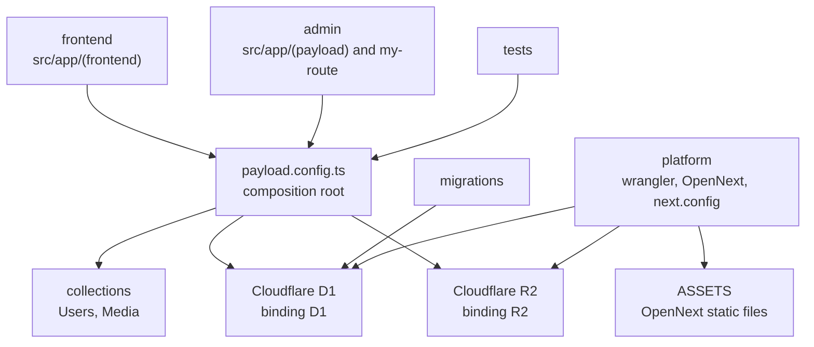
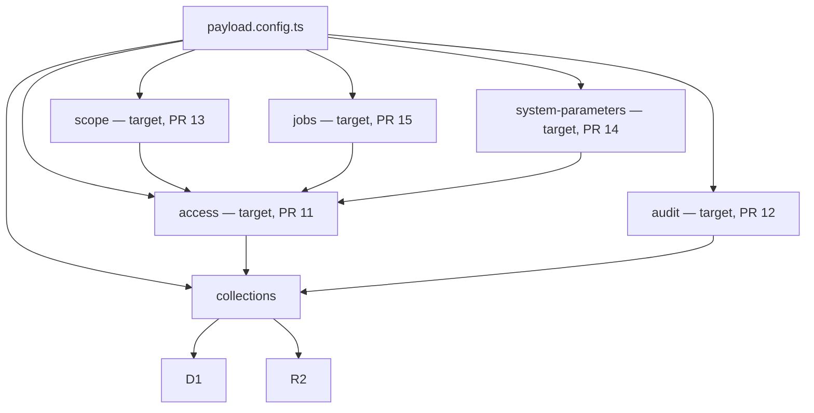

# Architecture

Last reviewed against `main` at `80cea96` (2026-10-10). This is the map of the code that is on `main`. Target-state sections are marked and are not directories in this tree.

## What this repository is

A Payload CMS 3.82.1 admin template on Next.js 16 (App Router) and React 19, deployed to Cloudflare Workers with `@opennextjs/cloudflare`. The database is Cloudflare D1 through `@payloadcms/db-d1-sqlite`. Uploads go to Cloudflare R2 through `@payloadcms/storage-r2`. The editor is Lexical.

Node `>=24.15.0`. Package manager is pnpm 9, 10, or 11. Wrangler is `~4.116.0`.

## Current modules

These are the real boundaries on `main`. Area labels, when someone with permission creates them, use the `area:` name in the table.

| Module | Area label | Path | Responsibility |
| --- | --- | --- | --- |
| frontend | `area:frontend` | `src/app/(frontend)` | Public homepage. Reads the session with `payload.auth` and links to the admin panel. |
| admin | `area:admin` | `src/app/(payload)`, `src/app/my-route` | Payload admin UI, REST (`/api/...`), GraphQL (`/api/graphql`), and the GraphQL playground. `src/app/my-route/route.ts` is a sample `GET` that loads Payload and returns a fixed message. |
| collections | `area:collections` | `src/collections` | Domain records. `Users` is the auth collection (email as title, no extra fields, versions off). `Media` is a public-read upload with a required `alt`. Crop and focal point are off because Workers has no `sharp`. |
| persistence | `area:persistence` | `src/migrations` | D1 schema. One migration, `20250929_111647`, exported from `src/migrations/index.ts`. |
| platform | `area:platform` | `wrangler.jsonc`, `open-next.config.ts`, `next.config.ts`, the Cloudflare context in `src/payload.config.ts` | Worker name `my-app`, compatibility date `2025-08-15`, flags `nodejs_compat` and `global_fetch_strictly_public`. Bindings below. |
| tests | `area:tests` | `tests/` | `tests/int/api.int.spec.ts` (Vitest, jsdom) finds users. `tests/e2e` (Playwright) covers the homepage and the admin dashboard, list, and create screens. Helpers: `tests/helpers/login.ts`, `tests/helpers/seedUser.ts`. |

`src/payload.config.ts` is the composition root, not a seventh domain. It registers `Users` and `Media`, the Lexical editor, the D1 adapter, the R2 storage adapter, and a JSON logger used only when `NODE_ENV` is `production`.

### Generated files

Do not hand-edit these. Regenerate them with the scripts in `package.json`.

| File | Script |
| --- | --- |
| `src/payload-types.ts` | `pnpm generate:types:payload` |
| `cloudflare-env.d.ts` | `pnpm generate:types:cloudflare` (`wrangler types`) |
| `src/app/(payload)/admin/importMap.js` | `pnpm generate:importmap` |
| `src/app/(payload)/layout.tsx`, `admin/[[...segments]]/*`, `api/**/route.ts` | Payload's generated route handlers |

`cloudflare-env.d.ts` is a large generated ambient file. It is not a module.

### Public entry points

| Entry | Who may import it |
| --- | --- |
| `src/payload.config.ts` default export, also `@payload-config` and `@/payload.config` | App routes and tests. |
| `Users` from `src/collections/Users.ts` | `src/payload.config.ts` only. |
| `Media` from `src/collections/Media.ts` | `src/payload.config.ts` only. |
| `migrations` from `src/migrations/index.ts` | Payload's migration runner. |

App routes call `getPayload` and the generated Payload route helpers. They do not import collection files. Collection files do not import `src/app`. That is the rule: no deep imports across modules.

### Dependency direction

Arrows point toward the dependency. `platform` does not import TypeScript modules. Wrangler and OpenNext read it at build and deploy time.

### External services and bindings

From `wrangler.jsonc` on `main`:

| Binding | Resource | Notes |
| --- | --- | --- |
| `D1` | D1 database `my-app` | `database_id` is still the placeholder `DATABASE_ID`. `remote: true`. |
| `R2` | R2 bucket `my-app` | Used by the `media` collection. |
| `ASSETS` | OpenNext static assets | Directory `.open-next/assets`. |

There is no Durable Object, Queue, KV namespace, service binding, or cron trigger on `main`. The `services` array and the staging `env` block are comments.

`PAYLOAD_SECRET` is a local env var (`.env.example`) and is described as a Worker secret in `package.json` (`cloudflare.bindings`). It is not a var in `wrangler.jsonc`. The production logger writes one JSON object per line to the console.

The dev and CLI path loads bindings through Wrangler's `getPlatformProxy`. The production Worker path uses `getCloudflareContext({ async: true })` from `@opennextjs/cloudflare`. That branch is the platform adapter. Collections never touch `env.D1` or `env.R2` themselves.

`next.config.ts` wraps the config with `withPayload` and marks `jose` and `pg-cloudflare` as server-external packages for workerd.

## Target boundaries

Not on `main`. Each row is a module an open pull request already builds. Do not add a directory for it on another branch. Issues #4, #6, #7, #8, and #10 have no code and no module yet.

| Target module | Pull request | What the pull request adds | How it should be reached |
| --- | --- | --- | --- |
| access | #11 | RBAC collections, `withRbac`, permission matrix. `docs/rbac.md` and `src/access` are named by that work. | `payload.config.ts` wraps a collection with `withRbac`. Other modules do not import access internals. |
| audit | #12 | Append-only `audit-logs`, `withAuditTrail`, `src/audit`. | `payload.config.ts` wraps a collection with `withAuditTrail`. The #12 merge notes say the wrap sits outside `withRbac` after #11 lands. |
| scope | #13 | Organizations, branches, data classes, and a row filter. `src/scope`, `docs/row-scope.md`. | A row-scope contributor registered next to access. Collection access functions from #11 stay as they are. |
| system-parameters | #14 | `system-parameters` collection and `getParameter`. `docs/system-parameters.md`. | Callers use `getParameter`. They do not read the D1 table or the cache row. |
| jobs | #15 | `jobs` collection, a typed job registry, `custom-worker.ts`, admin monitor at `/admin/job-monitor`. | Only registered job names run. The queue and scheduled handlers forward to one internal route. They do not import a second copy of Payload. |

Target dependency direction, after those pull requests merge in the order in `docs/STATUS.md`:

`access --> collections` means the access wrapper decorates a collection config. It does not mean a collection file imports the access package. The collection file stays a `CollectionConfig`. The composition root applies the wrappers.

Still out of scope until an issue gains code: the notification outbox (#6), the state machine (#7), the data grid (#8), IP and time windows (#4), and the script runner (#10). Adding an empty module for one of those would be a speculative abstraction.

## Rules for the next module

1. Put the new code in one directory with one public file that `src/payload.config.ts` imports.
2. Talk to D1, R2, or a future binding only through that public file or through the existing adapter in `payload.config.ts`.
3. Do not import another module's internal file. Import its public entry, or lift the shared call into the composition root.
4. Do not add an interface that has one implementation.
5. Leave generated files generated.
