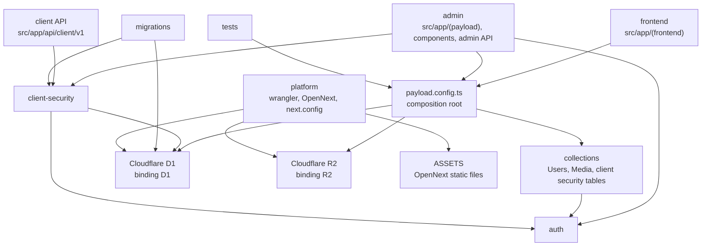
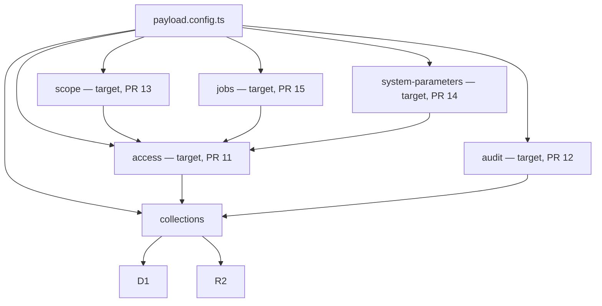

# Architecture

Last reviewed against `main` at `cf8414d` (2026-10-17). This is the map of the code that is on `main`. Target-state sections are marked and are not directories in this tree.

## What this repository is

A Payload CMS 3.82.1 admin template on Next.js 16.4 (App Router, webpack build) and React 19.3, deployed to Cloudflare Workers with `@opennextjs/cloudflare` 1.20.11. The database is Cloudflare D1 through `@payloadcms/db-d1-sqlite`. Uploads go to Cloudflare R2 through `@payloadcms/storage-r2`. The editor is Lexical. Firebase native clients (App Check plus Anonymous Authentication ID tokens) are verified with `jose`, separately from Payload admin sessions. License: MIT.

Node 22 (`.nvmrc`), `engines.node` `>=22.14.0`. Package manager is pnpm 9, 10, or 11. Wrangler is `~4.116.0` (4.116.0 in the lockfile). Exact versions are in `pnpm-lock.yaml`.

## Current modules

These are the real boundaries on `main`. Use the `area:` label in the table. `auth` and `client-security` have no dedicated label yet.

| Module | Area label | Path | Responsibility |
| --- | --- | --- | --- |
| frontend | `area:frontend` | `src/app/(frontend)` | Public homepage. Reads the session with `payload.auth` and links to the admin panel. |
| admin | `area:admin` | `src/app/(payload)`, `src/components`, `src/app/api/admin/client-security`, `src/app/my-route` | Payload admin UI, REST (`/api/...`), GraphQL (`/api/graphql`), and the GraphQL playground. The custom admin view `/admin/client-security` (`ClientSecurityView`, `ClientSecurityPanel`, nav link `ClientSecurityNav`) and its settings API `/api/admin/client-security`. `src/app/my-route/route.ts` is a sample `GET` from the starter template; #26 removes it. |
| client API | `area:platform` | `src/app/api/client/v1` | Native client routes. `GET /api/client/v1/me` is the example: it runs through the managed Firebase client route and returns the verified principal. |
| auth | — | `src/auth` | `firebase-client.ts` verifies Firebase App Check and ID tokens. `firebase-client-route.ts` is the reusable route adapter plus ownership and quota-key helpers. `client-security-owner.ts` defines the `owner` / `admin` / `editor` roles and the `Users` hooks that guard owner changes. |
| client-security | — | `src/client-security` | Owner-managed Firebase trust settings and per-client rate limits: configuration schema and validation, the revisioned D1 store, rate limiting, the admin and client route factories, and the schema initializer used by the migration. |
| collections | `area:collections` | `src/collections` | `Users` is the auth collection with a `role` field that only an owner can change. `Media` is a public-read upload with a required `alt`; crop and focal point are off because Workers has no `sharp`. `ClientSecurityCollections` are hidden, owner-read tables (`client-security-state`, `-versions`, `-counters`, `-audit`); Payload rejects direct writes and the `client-security` store owns them. |
| persistence | `area:persistence` | `src/migrations` | D1 schema. Migrations `20250929_111647` and `20261013_120000` (client security tables and the `users.role` column), exported in order from `src/migrations/index.ts`. |
| platform | `area:platform` | `wrangler.jsonc`, `open-next.config.ts`, `next.config.ts`, the Cloudflare context in `src/payload.config.ts` | Worker name `my-app`, compatibility date `2025-08-15`, flags `nodejs_compat` and `global_fetch_strictly_public`. Bindings below. |
| tests | `area:tests` | `tests/` | `tests/unit` (Node test runner) covers Firebase verification, the route adapter, owner rules, the settings schema, and the store. `tests/int` (Vitest, Node environment, isolated local D1/R2) covers Payload and the client security flow. `tests/e2e` (Playwright) covers the homepage and the admin screens and is not in CI yet. |
| tooling | `area:platform` | `scripts/`, `.github/workflows` | `scripts/ci-local.sh` (`pnpm ci:local`) and the `ci` workflow (job `verify`) run the same checks. Other scripts are local QA helpers and the operator-only first-owner bootstrap. |

`src/payload.config.ts` is the composition root, not a separate domain. It registers `Users`, `Media`, and `ClientSecurityCollections`, the client security admin view and nav link, the Lexical editor, the D1 adapter, the R2 storage plugin, and a JSON logger used only when `NODE_ENV` is `production`.

### Generated files

Do not hand-edit these. Regenerate them with the scripts in `package.json`.

| File | Script |
| --- | --- |
| `src/payload-types.ts` | `pnpm generate:types:payload` |
| `cloudflare-env.d.ts` | `pnpm generate:types:cloudflare` (`wrangler types`) |
| `src/app/(payload)/admin/importMap.js` | `pnpm generate:importmap` |
| `src/app/(payload)/layout.tsx`, `admin/[[...segments]]/*`, `api/**/route.ts` | Payload's generated route handlers |

`cloudflare-env.d.ts` is a large generated ambient file. It is not a module.

### Public entry points

| Entry | Who may import it |
| --- | --- |
| `src/payload.config.ts` default export, also `@payload-config` and `@/payload.config` | App routes and tests. |
| `Users`, `Media`, `ClientSecurityCollections` from `src/collections` | `src/payload.config.ts` only. |
| `src/auth/*` exports | `src/collections`, `src/client-security`, `src/components`, and tests. |
| `createClientSecurityAdminRoute`, `createManagedFirebaseClientRoute`, `cloudflareClientIp` from `src/client-security` | The matching routes under `src/app/api`. |
| `src/client-security/initialize.ts` and `schema.ts` | Migration `20261013_120000`. `schema.ts` types also feed `ClientSecurityPanel`. |
| `migrations` from `src/migrations/index.ts` | Payload's migration runner. |

App routes call `getPayload`, the generated Payload route helpers, or a route factory from `src/client-security`. They do not import collection files. Collection files do not import `src/app`. That is the rule: no deep imports across modules.

### Dependency direction

Arrows point toward the dependency. `platform` does not import TypeScript modules. Wrangler and OpenNext read it at build and deploy time.

### External services and bindings

From `wrangler.jsonc` on `main`:

| Binding | Resource | Notes |
| --- | --- | --- |
| `D1` | D1 database `my-app` | `database_id` is still the placeholder `DATABASE_ID`. `remote: true`. |
| `R2` | R2 bucket `my-app` | Used by the `media` collection. |
| `ASSETS` | OpenNext static assets | Directory `.open-next/assets`. |

Vars: `FIREBASE_CLIENT_ENABLED` (`"false"`), `FIREBASE_PROJECT_ID`, `FIREBASE_PROJECT_NUMBER`, and `FIREBASE_APP_IDS` (all empty). Owners manage the live trust settings at `/admin/client-security`; see `docs/firebase-client-auth.md`.

There is no Durable Object, Queue, KV namespace, service binding, or cron trigger on `main`. The `services` array is empty and the staging `env` block is a comment.

`PAYLOAD_SECRET` is a local env var (`.env.example`) and is described as a Worker secret in `package.json` (`cloudflare.bindings`). It is not a var in `wrangler.jsonc`. The production logger writes one JSON object per line to the console.

The dev, CLI, and build path loads bindings through Wrangler's `getPlatformProxy`; tests use an isolated local store. The production Worker path uses `getCloudflareContext({ async: true })` from `@opennextjs/cloudflare`. That branch is the platform adapter. Collections never touch `env.D1` or `env.R2` themselves; the client security routes get `env.D1` from `getCloudflareContext` and pass it to the store.

`next.config.ts` wraps the config with `withPayload` and marks `jose` and `pg-cloudflare` as server-external packages for workerd.

Worker plan: see the README note on Workers plans. The 64 MiB uncompressed size limit applies to Free and Paid; a local build is about 15.5 MiB uncompressed. CPU time and startup time are not measured yet.

## Target boundaries

Not on `main`. Each row is a module an open pull request already builds. These pull requests branch from `80cea96`, before #21/#22, so they do not yet account for the `auth` and `client-security` modules or the `users.role` field. Do not add a directory for it on another branch. Issues #4, #6, #7, #8, and #10 have no code and no module yet.

| Target module | Pull request | What the pull request adds | How it should be reached |
| --- | --- | --- | --- |
| access | #11 | RBAC collections, `withRbac`, permission matrix. `docs/rbac.md` and `src/access` are named by that work. | `payload.config.ts` wraps a collection with `withRbac`. Other modules do not import access internals. |
| audit | #12 | Append-only `audit-logs`, `withAuditTrail`, `src/audit`. | `payload.config.ts` wraps a collection with `withAuditTrail`. The #12 merge notes say the wrap sits outside `withRbac` after #11 lands. |
| scope | #13 | Organizations, branches, data classes, and a row filter. `src/scope`, `docs/row-scope.md`. | A row-scope contributor registered next to access. Collection access functions from #11 stay as they are. |
| system-parameters | #14 | `system-parameters` collection and `getParameter`. `docs/system-parameters.md`. | Callers use `getParameter`. They do not read the D1 table or the cache row. |
| jobs | #15 | `jobs` collection, a typed job registry, `custom-worker.ts`, admin monitor at `/admin/job-monitor`. | Only registered job names run. The queue and scheduled handlers forward to one internal route. They do not import a second copy of Payload. |

Target dependency direction, once those pull requests are on `main`:

`access --> collections` means the access wrapper decorates a collection config. It does not mean a collection file imports the access package. The collection file stays a `CollectionConfig`. The composition root applies the wrappers.

Still out of scope until an issue gains code: the notification outbox (#6), the state machine (#7), the data grid (#8), IP and time windows (#4), and the script runner (#10). Adding an empty module for one of those would be a speculative abstraction.

## Rules for the next module

1. Put the new code in one directory with one public file that `src/payload.config.ts` imports.
2. Talk to D1, R2, or a future binding only through that public file or through the existing adapter in `payload.config.ts`.
3. Do not import another module's internal file. Import its public entry, or lift the shared call into the composition root.
4. Do not add an interface that has one implementation.
5. Leave generated files generated.
